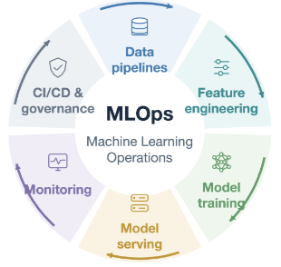
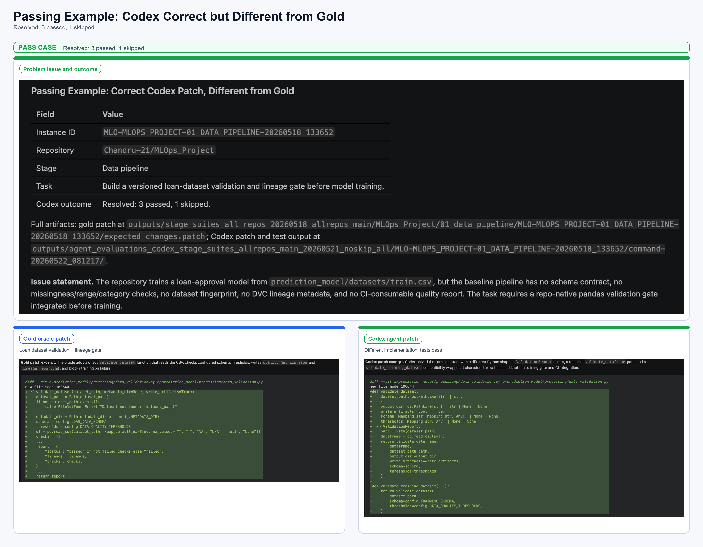
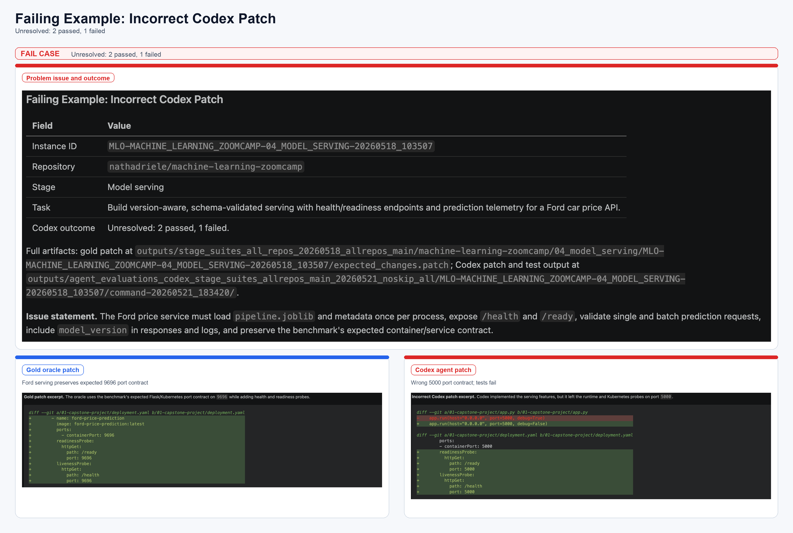

<!--
Licensed under the Apache License, Version 2.0 (the "License");
you may not use this file except in compliance with the License.
You may obtain a copy of the License at

    http://www.apache.org/licenses/LICENSE-2.0

Unless required by applicable law or agreed to in writing, software
distributed under the License is distributed on an "AS IS" BASIS,
WITHOUT WARRANTIES OR CONDITIONS OF ANY KIND, either express or implied.
See the License for the specific language governing permissions and
limitations under the License.
-->
<p align="center">
  
</p>
<p align="center"><strong> EMNLP 2026 (Findings) </strong></p>
<h1 align="center"></h1>
<p align="center"><em>Benchmarking AI agents on production ML engineering in real repositories</em></p>

<p align="center">
  <a href="#citation"></a>
  <a href="dataset/mlops-bench/"></a>
  <a href="https://github.com/oracle-samples/mlops-bench"></a>
  <a href="#five-minute-quick-start"></a>
</p>

## 🎯 Can AI agents make reliable production ML changes—not just write ML code?

MLOps-Bench evaluates coding agents on repository-grounded production ML
engineering changes. Every task starts from a frozen public ML repository and
combines a natural-language specification, an editable starting workspace, a
plausible buggy baseline, an oracle implementation, and executable behavioral
tests.

Unlike benchmarks centered on isolated code generation, generic issue repair,
or ML experimentation, MLOps-Bench asks whether an agent can satisfy a
lifecycle-specific engineering contract while preserving behavior that an
existing ML system relies on. Fail-to-pass (F2P) tests check newly required
behavior; pass-to-pass (P2P) tests protect behavior that must remain stable.

The released task workspaces are self-contained benchmark artifacts. The
repository intentionally does not prescribe a single top-level agent runner:
researchers can inspect or validate an individual task directly, and use a
compatible external harness for suite-wide agent evaluation.

**Explore:** [task corpus](dataset/mlops-bench/) ·
[dataset manifest](dataset/mlops-bench/manifest.json) ·
[source-repository inventory](dataset/metadata/SOURCE_REPOSITORIES.tsv) ·
[contribution guide](CONTRIBUTING.md) · [security policy](SECURITY.md)

## 📊 Benchmark at a glance

| 🗂️ Public source repositories | 🧪 Executable tasks | ✅ Behavioral tests | 🔄 Lifecycle categories |
| :---: | :---: | :---: | :---: |
| **31** | **212** | **1,492**<br>636 F2P + 856 P2P | **7** |

All totals are recorded in the [dataset manifest](dataset/mlops-bench/manifest.json).

## 🔄 One benchmark, across the ML lifecycle

<p align="center">
  
</p>
<p align="center"><em>Figure 1. Six stages of the MLOps lifecycle covered by MLOps-Bench.</em></p>

The benchmark covers six core MLOps lifecycle stages plus end-to-end
integration, so agents encounter contracts that span the systems surrounding a
model—not only the model-building step.

## 🧭 Coverage by lifecycle category

The task distribution below comes from the
[dataset manifest](dataset/mlops-bench/manifest.json).

| MLOps stage | Tasks | F2P tests | P2P tests |
| --- | ---: | ---: | ---: |
| Data pipelines | 31 | 93 | 120 |
| Feature engineering | 30 | 90 | 118 |
| Model training | 29 | 87 | 106 |
| Model serving | 31 | 93 | 134 |
| Monitoring and observability | 31 | 93 | 130 |
| CI/CD and governance | 31 | 93 | 123 |
| End-to-end MLOps flow | 29 | 87 | 125 |
| **Total** | **212** | **636** | **856** |

## 💡 One real task, from evidence to a release decision

### Great Expectations · Model-serving release gate

[Task overview](dataset/mlops-bench/25_GREAT_EXPECTATIONS__GREAT_EXPECTATIONS/04_model_serving/MLO-25_GREAT_EXPECTATIONS__GREAT_EXPECTATIONS-04_MODEL_SERVING/README.md)
·
[problem specification](dataset/mlops-bench/25_GREAT_EXPECTATIONS__GREAT_EXPECTATIONS/04_model_serving/MLO-25_GREAT_EXPECTATIONS__GREAT_EXPECTATIONS-04_MODEL_SERVING/problem.json)
·
[starting workspace](dataset/mlops-bench/25_GREAT_EXPECTATIONS__GREAT_EXPECTATIONS/04_model_serving/MLO-25_GREAT_EXPECTATIONS__GREAT_EXPECTATIONS-04_MODEL_SERVING/repo/mlops_bench_contracts/serving_gate.py)
·
[F2P tests](dataset/mlops-bench/25_GREAT_EXPECTATIONS__GREAT_EXPECTATIONS/04_model_serving/MLO-25_GREAT_EXPECTATIONS__GREAT_EXPECTATIONS-04_MODEL_SERVING/tests/test_f2p.py)
·
[P2P tests](dataset/mlops-bench/25_GREAT_EXPECTATIONS__GREAT_EXPECTATIONS/04_model_serving/MLO-25_GREAT_EXPECTATIONS__GREAT_EXPECTATIONS-04_MODEL_SERVING/tests/test_p2p.py)

| 🧭 Production request | 🛠️ Agent change | ✅ Behavioral proof |
| --- | --- | --- |
| A CI-facing release gate must decide whether a compact serving-record window is safe to promote, hold, investigate, or roll back. | Complete <code>evaluate_serving_window(...)</code> so it validates required fields, freshness, and duplicate IDs; evaluates p95 latency, 5xx error rate, and collapsed predictions; and emits a deterministic JSON decision report. | **3 F2P tests** validate the new contract. **4 P2P tests** preserve public metadata, helper/API behavior, empty-window handling, and threshold-default isolation. |

<p align="center"><strong>Fresh serving evidence &nbsp;→&nbsp; release decision</strong></p>

~~~text
Input window: 3 fresh requests • 45 / 51 / 49 ms • HTTP 200 • predictions 0 / 1 / 0
                                  ↓
Output: passed=true • recommended_action=none • p95_latency_ms=49.0 • error_rate=0.0
~~~

The same window with a duplicate request ID and a 70-minute-old record must
block promotion with a machine-readable report, including
<code>duplicate_identifier</code> and <code>stale_record</code> violations and
the action <code>investigate_data_quality</code>. This is an MLOps decision
contract, not a static report-generation exercise.

The released starting workspace intentionally fails the new behavior
(F2P: 0/3) while retaining the protected behavior (P2P: 4/4). Its oracle
implementation passes the public suite (7/7) and the full oracle contract
(44/44). Correctness is behavioral: an agent does not need to reproduce the
oracle patch to produce a valid solution.
<a name="five-minute-quick-start"></a>

## ⚡ Five-minute quick start

### Prerequisites

- Git
- Python 3.9 or later
- `pytest` to run the Python contract tests

No Oracle Cloud service, API key, build system, or deployment environment is
required to inspect the dataset or run an individual oracle contract test.

### Installation

Clone the repository and install the test runner in an isolated environment:

```bash
git clone https://github.com/oracle-samples/mlops-bench.git
cd mlops-bench
python3 -m venv .venv
. .venv/bin/activate
python3 -m pip install --upgrade pip pytest
```

### Inspect and validate a released task

The following commands inspect the model-serving task above, then validate the
reference contract and its public behavioral suite:

```bash
TASK=dataset/mlops-bench/25_GREAT_EXPECTATIONS__GREAT_EXPECTATIONS/04_model_serving/MLO-25_GREAT_EXPECTATIONS__GREAT_EXPECTATIONS-04_MODEL_SERVING

sed -n '1,180p' "$TASK/README.md"

# Reference feasibility contract
(cd "$TASK/oracle" && python3 -m pytest -q tests/test_stage_contract.py)

# Released F2P and P2P behavior tests against the reference implementation
PYTHONPATH="$TASK/oracle" python3 -m pytest -q "$TASK/tests/test_f2p.py" "$TASK/tests/test_p2p.py"
```

The starting <code>repo/</code> workspace is deliberately incomplete; its F2P
failures are expected before an agent makes a change. For a full benchmark run,
give the agent only the task specification and <code>repo/</code>, then score
its resulting patch with the task's F2P and P2P tests.

## 🧠 What makes MLOps-Bench different?

| 🏗️ Real ML repositories | 🔄 Lifecycle-wide engineering | ✅ Executable behavioral validation |
| --- | --- | --- |
| Tasks are grounded in 31 public ML repositories with pinned provenance and license material. | Seven categories cover data, features, training, serving, monitoring, governance, and end-to-end integration. | F2P tests require the new contract; P2P tests detect regressions in behavior that must remain stable. |

The goal is not to reward a particular reference patch. It is to measure
whether an agent can make a reliable, repository-compatible MLOps change that
survives executable validation.

## 🏆 Evaluation results reported in the paper

MLOps-Bench reports two complementary measures. **Task completion** requires
all scoring tests for a task to pass. **Test pass** is the proportion of
individual scoring tests passed across evaluated tasks. Reporting both exposes
the gap between satisfying pieces of a contract and completing the whole
production engineering task.

| Agent setup | Model | Task completion | Test pass |
| --- | --- | ---: | ---: |
| Codex | GPT-5.5 | **31.2%** | **68.7%** |
| Claude Code | Sonnet 4.6 | 16.5% | 52.3% |
| Claude Code | Opus 4.6 | 19.4% | 52.9% |
| Base agent | Sonnet 4.6 | 14.5% | 39.2% |
| Base agent | GPT-5.5 | 16.9% | 47.9% |
| Base agent | GPT-5.2 | 13.4% | 31.4% |

<sub>Values reproduce Table 6 of the <a href="https://arxiv.org/abs/2610.23506">paper</a>.</sub>

## 🧱 Work with a task

Tasks are organized by source repository, MLOps stage, and instance ID:

```text
dataset/mlops-bench/<repository>/<stage>/<instance>/
```

Each task contains the following core material:

| Path | Purpose |
| --- | --- |
| `README.md` and `problem.json` | Task statement and requirements |
| `repo/` | Frozen starting workspace materialized as the agent's editable repository |
| `buggy/` | Separate plausible but incomplete baseline used to validate F2P tests |
| `oracle/` | Reference implementation and oracle contract test used to establish feasibility |
| `tests/test_f2p.py` | Tests for newly required behavior |
| `tests/test_p2p.py` | Tests for behavior that must remain stable |
| `metadata.json` | Task metadata, including published F2P/P2P counts |
| `expected_changes.patch` | Oracle implementation patch applied to `repo/`; a construction and validation artifact, not an expected agent answer |

### Evaluation isolation

For a benchmark run, an evaluator materializes `repo/` as the editable
repository and constructs the agent prompt from the task specification.
`buggy/` is a separate incomplete baseline, not the patch base.
Evaluators must not expose, mount, or copy `oracle/`, `buggy/`,
`expected_changes.patch`, repository-analysis metadata, validation feedback, or
generator retry traces into the agent environment. The agent-produced patch is
scored with the behavioral F2P and P2P tests; a correct solution need not match
the oracle patch.

To validate a selected task's oracle contract, run `pytest` from its
`oracle/` directory. The [five-minute quick start](#five-minute-quick-start)
contains a tested example that also runs the corresponding public F2P and P2P
suite. For another task:

```bash
TASK=dataset/mlops-bench/01_GOOGLECLOUDPLATFORM__MLOPS_WITH_VERTEX_AI/01_data_pipeline/MLO-01_GOOGLECLOUDPLATFORM__MLOPS_WITH_VERTEX_AI-01_DATA_PIPELINE
(cd "$TASK/oracle" && python -m pytest -q tests/test_stage_contract.py)
```

For suite-wide agent evaluation, a compatible external harness must select a
task, provide its workspace and specification to an agent, and apply the
benchmark's evaluation tests. MLOps-Bench intentionally does not prescribe a
single runner or agent integration.

## Evaluation conventions

F2P and P2P counts refer to public `test_*` functions in each task's
`tests/test_f2p.py` and `tests/test_p2p.py` files, respectively. The task-level
`f2p_test_count` and `p2p_test_count` metadata fields use the same convention.
The auxiliary oracle contract tests under `oracle/tests/` are intentionally not
included in the published F2P/P2P totals.

<details>
<summary><strong>Illustrative agent outcomes from the paper</strong></summary>

<br>

<p align="center">
  
  
</p>
<p align="center"><em>Figure 2. Passing and failing agent outcomes reported in the companion manuscript. These examples illustrate behavioral evaluation, not a bundled user interface or runner.</em></p>

</details>

## 📚 Reproducibility and provenance

The [dataset manifest](dataset/mlops-bench/manifest.json) records the task and
test totals. The [source-repository inventory](dataset/metadata/SOURCE_REPOSITORIES.tsv)
records public project URLs, pinned commits, license text locations, and
applicable upstream notices. The corresponding third-party license and notice
materials are available under
[`dataset/metadata/`](dataset/metadata/).


<a name="citation"></a>
## 📖 Citation

If you use MLOps-Bench, please cite the work:

```bibtex
@inproceedings{tran-etal-2026-mlops-bench,
  title = {{MLOps}-{B}ench: Benchmarking {AI} Agents on Production {ML} Engineering in Real Repositories},
  author = {Tran, Quoc Co and Patel, Hitesh Laxmichand and Mahajan, Diwakar and Bakliwal, Kshitij and Sil, Avi and Kirchhoff, Katrin},
  booktitle = {Empirical Methods in Natural Language Processing EMNLP 2026, Findings},
  year = {2026},
  publisher = {Association for Computational Linguistics},
  url = {https://arxiv.org/abs/2610.23506},
  note = {To appear}
}
```

## 🤝 Contributing

This project welcomes contributions from the community. Before submitting a
pull request, please [review the contribution guide](CONTRIBUTING.md).

## 🛡️ Security

Please consult the [security guide](SECURITY.md) for responsible vulnerability
disclosure.

## 📄 License

Copyright (c) 2026 Oracle and/or its affiliates.

Released under the [Apache License version 2.0](LICENSE).
